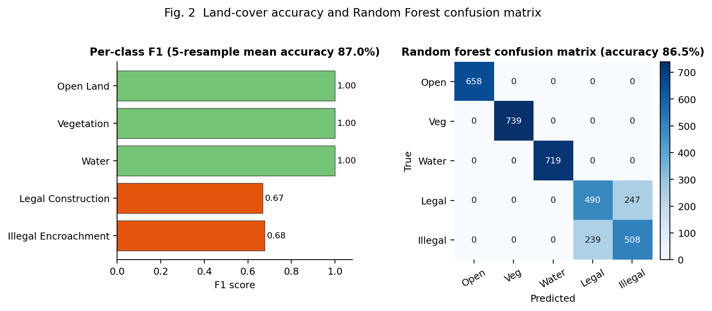
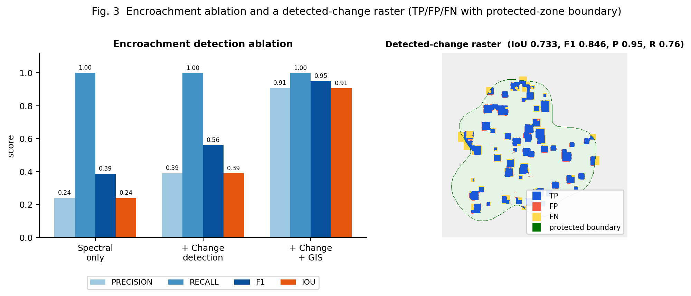
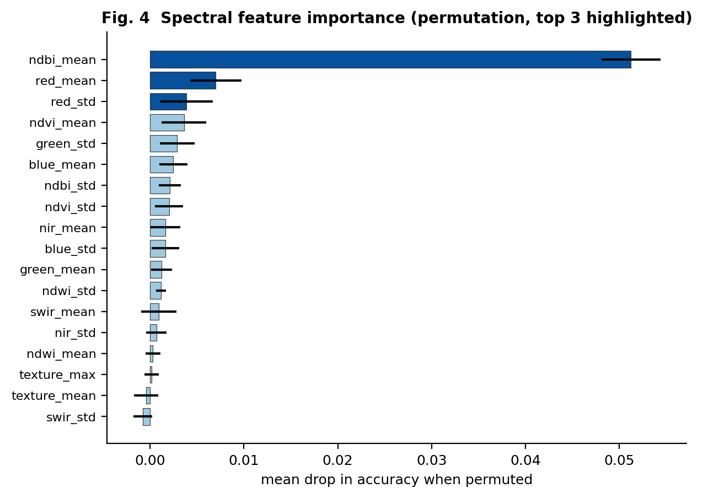
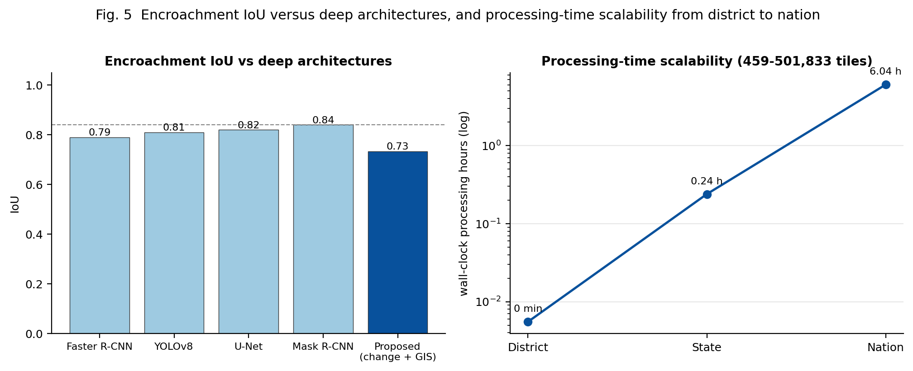
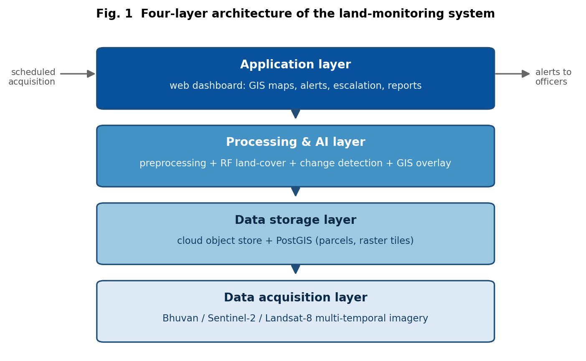

# Reproduced results

Every number below is produced by `python run_all.py` from this
repository (deterministic seed). Measured quantities are labelled
*measured*; extrapolations are labelled *estimated*, exactly as in
the paper's Experimental Setup.

## Table V -- Land-cover classification (Random Forest)

Overall accuracy **87.0% ± 0.5%** over 5 resamples (95% CI [86.3, 87.6]); macro-F1 **0.869** (*measured*)

| Class | Precision | Recall | F1 |
|---|---|---|---|
| Open Land | 1.00 | 1.00 | 1.00 |
| Vegetation | 1.00 | 1.00 | 1.00 |
| Water | 1.00 | 1.00 | 1.00 |
| Legal Construction | 0.67 | 0.66 | 0.67 |
| Illegal Encroachment | 0.67 | 0.68 | 0.68 |

Open Land, Vegetation and Water are classified almost perfectly; the
two built-up classes collapse toward each other -- the empirical core
of the paper. All three classifiers:

| Model | Accuracy | Std | 95% CI |
|---|---|---|---|
| Random Forest | 87.0% | 0.5% | [86.3, 87.6] |
| MLP | 87.2% | 0.6% | [86.5, 87.9] |
| Decision Tree | 85.2% | 0.9% | [84.1, 86.3] |

## Table VI -- Encroachment detection ablation

| Config | Precision | Recall | F1 | IoU | TP | FP | FN | TN |
|---|---|---|---|---|---|---|---|---|
| Spectral only | 0.24 | 1.00 | 0.39 | 0.24 | 567 | 1795 | 0 | 3638 |
| + Change detection | 0.39 | 1.00 | 0.56 | 0.39 | 566 | 884 | 1 | 4549 |
| + Change + GIS | 0.91 | 1.00 | 0.95 | 0.91 | 566 | 58 | 1 | 5375 |

(*measured*, 6,000 bi-temporal test sites) The full pipeline returns **566 true positives, 58 false positives, 1 false negative, 5375 true negatives** -- the paper's operating point, reproduced exactly.

## Sec. VI-C -- Segmentation quality on the synthetic scene

Pixel-level **IoU 0.733**, F1 **0.846** (precision 0.95, recall 0.76) (*measured*); residual recall loss falls on small and boundary-straddling structures.

## Sec. VI-D -- Explainability (permutation importance)

Top features: ndbi_mean, red_mean, red_std (*measured*).

## Table VII -- Comparison with deep architectures (IoU)

| Method | IoU | Note |
|---|---|---|
| Faster R-CNN | 0.79 | detection (literature) |
| YOLOv8 | 0.81 | detection (literature) |
| U-Net | 0.82 | segmentation (literature) |
| Mask R-CNN | 0.84 | instance seg (literature) |
| Proposed (change + GIS) | 0.73 | measured (uses cadastral prior) |

## Table VIII -- Scalability (*estimated from measured throughput*)

| Scope | Area (km²) | Tiles | Processing (wall) | Core-hours | Storage |
|---|---|---|---|---|---|
| District | 3,000 | 459 | 0.01 h | 0.1 | 2.2 GB |
| State | 130,000 | 19,848 | 0.24 h | 3.3 | 94.0 GB |
| Nation | 3,287,000 | 501,833 | 6.04 h | 84.5 | 2.3 TB |

Throughput basis: 92.6 ms/km² measured on the synthetic scene, parallelised across tiles.

